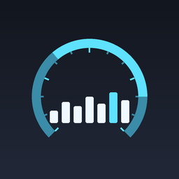

# iOS-MetalHUD-Injector

<p align="center">
  
</p>

<p align="center">
  <a href="README.md">简体中文</a> ·
  <b>English</b> ·
  <a href="README.zh-TW.md">繁體中文</a>
</p>

<p align="center">
  Launch any <b>App Store app</b> from the device itself with <code>MTL_HUD_ENABLED</code>
  injected, so the Metal performance HUD (live FPS / frame time) shows up.
  No Mac, no Xcode, no jailbreak.
</p>

<p align="center">
  <a href="https://github.com/wurezhwe/iOS-MetalHUD-Injector/actions/workflows/build.yml">
    
  </a>
</p>

---

## What this is

The **Developer → Show Graphics HUD** switch in Settings only applies to processes
carrying the `get-task-allow` entitlement (Xcode debug builds and self-signed
apps). App Store apps don't have it, which is why the switch appears to do
nothing for them.

Metal, however, reads process environment variables when it initialises, and
that path **never consults the code signature**:

| Variable | Effect |
| --- | --- |
| `MTL_HUD_ENABLED` | `1` turns the HUD on |
| `MTL_HUD_SCALE` | HUD size, e.g. `0.35` |
| `MTL_HUD_ALIGNMENT` | e.g. `top-right` |
| `MTL_HUD_LOG_ENABLED` | `1` also mirrors HUD data into the log |

Get those variables into the target process at launch and the HUD appears.
That is exactly what this project does:

1. The app runs **on your own device** and reaches the device's own RSD
   (Remote Service Discovery) port through a **loopback VPN** (LocalDevVPN, or
   the WireGuard profile SideStore installs);
2. RemotePairing performs pair-verify and establishes a TLS-PSK tunnel;
3. Inside that tunnel we connect to the internal RSD and call
   **CoreDevice `appservice`**'s `launchapplication`, passing
   `environmentVariables` along;
4. The target app starts with the HUD injected.

On macOS this same chain is `devicectl device process launch -e`, and
`devicectl` only exists on macOS — which is why "run a client on the device
itself" is the interesting part.

## Relation to the reference projects

| Reference | What was borrowed |
| --- | --- |
| [wurezhwe/iOS-MetalHUD-Launcher](https://github.com/wurezhwe/iOS-MetalHUD-Launcher) | The `MTL_HUD_*` variable list, the `launch --env` approach |
| [Mak5er/AirCard-iOS](https://github.com/Mak5er/AirCard-iOS) | On-device RPPairing host (pair from Settings), loopback tunnel routing and candidate gateway sweep, the `idevice` RSD/CoreDevice call pattern |

The difference: the first one needs a **Windows PC with a USB cable** running
`pymobiledevice3`. This project does everything **on the device**
(pair → tunnel → launch) and ships as an IPA.

## Build

No Mac required. Fork the repo and let GitHub Actions build it:

```
Actions → Build IPA → Run workflow
```

After a successful build, `Release IPA` publishes the artifact to
[Releases](../../releases); the tag is the `MARKETING_VERSION` from
`project.yml` (currently **v1.2.0**):

```
https://github.com/wurezhwe/iOS-MetalHUD-Injector/releases/latest/download/MetalHUDLauncher.ipa
```

That link always points at the newest version and can be used directly. You can
also grab the `MetalHUDLauncher-ipa` artifact from an individual run (same file
inside a zip).

To cut a release, bump `MARKETING_VERSION` in `project.yml`; the next successful
build creates a new version tag. Re-building the same version overwrites the IPA
on the existing release.

Or, with a local macOS machine:

```bash
./scripts/build-rust.sh     # builds the Rust static lib into MetalHUDFFI.xcframework
brew install xcodegen
xcodegen generate
# then open MetalHUDLauncher.xcodeproj in Xcode, or reuse the xcodebuild command from CI
```

The resulting `MetalHUDLauncher.ipa` is **unsigned** and needs to be signed
before installation (see below).

## Install

An unsigned IPA cannot be installed as-is. Pick one:

| Method | Notes |
| --- | --- |
| **SideStore / AltStore** | Easiest and recommended: it produces a pairing file you can reuse here |
| **TrollStore** | Permanent install on supported iOS 14.0–17.0 devices |
| **iOS App Signer / Sideloadly** | Re-sign with your own developer certificate |
| **Xcode** | Run straight to the device |

> CI in this repo only compiles the IPA. It ships **no certificate or
> provisioning profile**.

## Usage

### 1. Set up a loopback VPN

Install [LocalDevVPN](https://apps.apple.com/app/localdevvpn/id6475003729) (free),
open it and connect. Its job is to forward addresses such as `10.7.0.1` to the
device's own developer-service ports.

If you already run **SideStore**, its bundled WireGuard loopback works too — the
gateway is also `10.7.0.1`.

### 2. Pair

Since iOS 27 an app can act as a "pairable host" and be approved from Settings:

1. Open Metal HUD and tap **Start pairing host**;
2. A 6-digit PIN appears on screen;
3. Go to **Settings → Privacy & Security → Developer Mode → Pair with MetalHUD**;
4. Enter the PIN.

Once paired, `metalhud_pairing.plist` is written to the app's Documents folder.

**Other pairing sources** (required on iOS 18–26):

- SideStore: `On My iPhone › SideStore › ALTPairingFile.mobiledevicepairing`
- LiveContainer + SideStore: `On My iPhone › LiveContainer › SideStore › Documents › ALTPairingFile.mobiledevicepairing`
- Generate one on a computer with `jitterbugpair` / `pymobiledevice3` and transfer it over

Tap **Import pairing file** in the app and pick it (the Documents folder is
exposed to the Files app via `UIFileSharingEnabled`).

### 3. Launch an app with the HUD

1. Tap refresh in the top right to load the installed-app list;
2. Search for the target app (Chinese, pinyin and initials all work — see below);
3. Adjust `Scale` / `Alignment` if you like;
4. Tap the play button.

Switch back to the target app and the HUD is there. **Screenshot** saves a PNG
as evidence.

### Search

All of these forms match:

| Input | Matches |
| --- | --- |
| `王者荣耀` | the Chinese display name directly |
| `wangzherongyao` | full pinyin |
| `wzry` | pinyin initials |
| `gen` / `com.mojang` | English name / bundle id substring |

The conversion happens **once**, when the app list loads (not on every
keystroke), and typing itself is debounced — so a few hundred apps stay smooth.

## Interface

The UI uses iOS 26's **Liquid Glass** material (`glassEffect`): the cards, the
search field and the buttons are real glass and follow the system's fluid
animations. On iOS 16–18 it falls back to a frosted material with an identical
layout.

| Section | Purpose |
| --- | --- |
| Pairing record | Whether a pairing file exists; Forget / Import |
| Gateway | RSD dial address, defaults to `10.7.0.1`; Apply re-pushes the candidate list |
| Probe | Opens a tunnel without launching anything and reports how many services the device exposes and whether appservice / dvt / screenshot channels exist |
| Metal HUD | see "HUD options" below |
| Installed apps | App list + search + games-only + launch |
| Tunnel log | Live tunnel/launch log, copyable |

**Light and dark mode** are both supported: the colour scheme is not forced, and
every colour follows the system appearance (light mode uses a deeper teal so
contrast stays readable).

**Fully localised** into **English / 简体中文 / 繁體中文**. The app follows the
system language on first launch, and the 🌐 button in the toolbar switches at any
time. No screen mixes languages.

### HUD options

Grouped the way the system's Graphics HUD options are:

| Option | Environment variable | Notes |
| --- | --- | --- |
| Enable Metal Performance HUD | `MTL_HUD_ENABLED` | Master switch. With it off **nothing is injected**, which makes this a control run equivalent to tapping the Home Screen icon |
| Scale | `MTL_HUD_SCALE` | HUD size, default `0.35` |
| Alignment | `MTL_HUD_ALIGNMENT` | Six values: top-left / top-right / bottom-left / bottom-right / top-center / bottom-center |
| Mirror to log | `MTL_HUD_LOG_ENABLED` | Advanced |
| Terminate before launch | — | Not an injection; a launch behaviour |
| Games only | — | Filters by publisher prefix and game-name keywords, and hides extensions/widgets |

The exact environment that will be injected is shown live underneath, with a
"reset to defaults" button at the end.

## Troubleshooting

**`could not reach the device`**
Wrong gateway or the VPN is not connected. Check the address under Gateway, then
tap Probe and read which addresses the log tried.

**`pair-verify rejected`**
The pairing file no longer matches this device (OS reinstall, different device,
or a file from elsewhere). Delete the pairing record and pair again.

**`the device never accepted a tunnel connection`**
The loopback VPN forwards the RSD port but not the ephemeral tunnel port the
device opens. Try another VPN, or reconnect and retry.

**Launch fails but the app list works**
Some games have anti-debug protection and refuse to start under a debugger;
those cannot be used with this tool.

**Probe reports `appservice=no`**
Normal. Plenty of OS builds do not advertise
`com.apple.coredevice.appservice` over RSD, but they always advertise
`com.apple.instruments.dtservicehub`. The tool falls back automatically in the
order DVT → CoreDevice → InstallationProxy, so nothing needs switching by hand.
It only becomes a real problem when the log shows `DVT application listing
failed` *and* a coredevice failure.

**No HUD**
First confirm the app really renders with Metal (most games and plenty of
ordinary apps do). Built-in system apps may ignore the variable.

## How it works (details)

```
┌───────────────────── inside the device ────────────────────────┐
│                                                                │
│   MetalHUDLauncher.app                                         │
│        │                                                       │
│        │  1. RPPairing host (Bonjour, PIN approved in Settings) │
│        ▼                                                       │
│   pairing file metalhud_pairing.plist                          │
│        │                                                       │
│        │  2. connect 10.7.0.1:49152 (RSD) → RemoteXPC handshake │
│        │     → RPPairing pair-verify                           │
│        │     → createListener yields a tunnel port             │
│        ▼                                                       │
│   TLS-PSK + CDTunnel handshake → RSD inside the tunnel          │
│        │                       (serverRSDPort)                 │
│        │                                                       │
│        │  3. pick the first working launch channel             │
│        │     a) DVT com.apple.instruments.dtservicehub          │
│        │        → processcontrol                                │
│        │        launchSuspendedProcessWithDevicePath:...        │
│        │     b) CoreDevice com.apple.coredevice.appservice      │
│        │        → launchapplication                             │
│        ▼                                                       │
│   environment {MTL_HUD_ENABLED: "1", MTL_HUD_SCALE: "0.35", …}  │
│        │                                                       │
│        ▼                                                       │
│   target app starts with the HUD                                │
└────────────────────────────────────────────────────────────────┘
```

Why two channels: `com.apple.coredevice.appservice` is not advertised over RSD
on every OS build (one measured iPadOS advertised 63 services without it), while
`dtservicehub` is almost always present. Both accept `environmentVariables`, so
the injection is identical either way.

The three modules in `rust-core`:

- `tunnel.rs` — dialling, pair-verify, the tunnel, the RSD handshake inside it
- `launch.rs` — listing apps (DVT → coredevice → InstallationProxy), launching
  (DVT → coredevice), screenshots (coredevice → screenshotr)
- `pairing.rs` — the on-device RPPairing host

## Repository layout

```
.
├── rust-core/                     # Rust static library (C ABI)
│   ├── src/
│   │   ├── lib.rs                 # the exported C surface
│   │   ├── tunnel.rs              # RemotePairing → RSD tunnel
│   │   ├── launch.rs              # app list / launch / screenshot
│   │   ├── pairing.rs             # on-device RPPairing host
│   │   ├── logging.rs             # log callback bridge
│   │   └── ffi_util.rs            # C strings and the big-stack runner
│   └── include/metalhud.h
├── ios-app/                       # SwiftUI app
│   ├── MetalHUDApp.swift
│   ├── ContentView.swift
│   ├── AppModel.swift
│   ├── AppSearchIndex.swift       # search index (pinyin / initials, folded once)
│   ├── GlassKit.swift             # Liquid Glass components + legacy fallback
│   ├── Bridge.swift               # FFI wrapper
│   ├── PairingController.swift    # pairing + Bonjour
│   ├── NetworkStatus.swift        # interfaces and candidate gateways
│   ├── Utilities.swift            # keep-alive / local network permission
│   └── Info.plist
├── scripts/
│   ├── build-rust.sh              # build Rust and package the xcframework
│   ├── make_icon.py               # generate the app icon
│   ├── check_readmes.py           # validate all three READMEs
│   └── check_locales.py           # ensure zh-CN/zh-TW don't leak into each other
├── README.md                      # 简体中文
├── README.en.md                   # English
├── README.zh-TW.md                # 繁體中文
├── project.yml                    # XcodeGen
└── .github/workflows/
    ├── build.yml                  # build the IPA
    └── release.yml                # publish using MARKETING_VERSION
```

## Compatibility

| iOS | Notes |
| --- | --- |
| 27.x | Supported; pair directly from Settings |
| 18 – 26.x | Supported; import a pairing file (SideStore / LiveContainer / generated on a computer) |
| 16 – 17.x | Should work with a pairing file you supply, but untested |

> On version numbers: Apple skipped straight from iOS 18 to **iOS 26** (switching
> to year-based numbering), so **iOS 19–25 do not exist**. The ranges above are
> 16, 17, 18, then 26 and 27.

## License

MIT. The reference projects are MIT as well.

`MTL_HUD_*` are undocumented environment variables of Apple's Metal runtime. This
project only passes them through the public CoreDevice interface and does not
modify any app.
