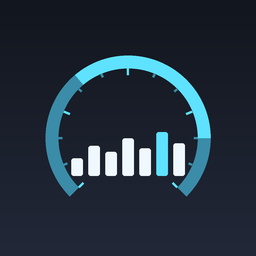

# iOS-MetalHUD-Injector

<p align="center">
  
</p>

<p align="center">
  <b>简体中文</b> ·
  <a href="README.en.md">English</a> ·
  <a href="README.zh-TW.md">繁體中文</a>
</p>

<p align="center">
  用一台 iPhone/iPad 自己启动 <b>App Store 应用</b> 并注入 <code>MTL_HUD_ENABLED</code>，
  让 Metal 性能 HUD（实时 FPS / 帧时间）显示出来。免 Mac、免 Xcode、不越狱。
</p>

<p align="center">
  <a href="https://github.com/wurezhwe/iOS-MetalHUD-Injector/actions/workflows/build.yml">
    
  </a>
</p>

---

## 这是什么

iOS 设置里 **开发者 → 显示图形 HUD** 这个开关只对带 `get-task-allow` 权限的进程生效
（Xcode 调试构建、自签应用）。App Store 应用没有这个权限，所以那个开关对它们完全无效。

但 Metal 运行时在进程启动时会读取环境变量，这条路径**不检查签名**：

| 变量 | 作用 |
| --- | --- |
| `MTL_HUD_ENABLED` | `1` 打开 HUD |
| `MTL_HUD_SCALE` | HUD 缩放，例如 `0.35` |
| `MTL_HUD_ALIGNMENT` | 对齐方式，例如 `top-right` |
| `MTL_HUD_LOG_ENABLED` | `1` 同时把 HUD 数据写进日志 |

只要能在启动目标进程时把这些变量塞进去，HUD 就会出来。本项目就是干这个的：

1. 应用在你自己的设备上运行，通过一个 **回环 VPN**（LocalDevVPN / SideStore 的 WireGuard）
   访问设备自身的 RSD（Remote Service Discovery）端口；
2. 用 RemotePairing 完成 pair-verify，建立 TLS-PSK 隧道；
3. 在隧道里连上设备内部 RSD，调用 **CoreDevice `appservice`** 的 `launchapplication`，
   把 `environmentVariables` 一起传过去；
4. 目标应用带着 HUD 启动。

这条链路上 Xcode 用的是 `devicectl device process launch -e`，而 `devicectl` 只有 macOS 有
——所以才需要"在设备上自己跑一个客户端"。

## 和参考项目的关系

| 参考 | 借鉴了什么 |
| --- | --- |
| [wurezhwe/iOS-MetalHUD-Launcher](https://github.com/wurezhwe/iOS-MetalHUD-Launcher) | `MTL_HUD_*` 环境变量清单、`launch --env` 这条思路、游戏类应用的启发式判断 |
| [Mak5er/AirCard-iOS](https://github.com/Mak5er/AirCard-iOS) | 设备内 RPPairing host（在设置里配对）、回环隧道路由与候选网关扫描、`idevice` 的 RSD/CoreDevice 调用方式 |

区别在于：前者必须在 **Windows 上插数据线**用 `pymobiledevice3` 启动；本项目**全程在设备上**完成
（配对 → 隧道 → 启动），产物是一个 IPA。

## 构建

不需要 Mac。Fork 本仓库，GitHub Actions 会自动构建：

```
Actions → Build IPA → Run workflow
```

构建成功后 `Release IPA` 会自动把产物发到 [Releases](../../releases)，tag 就是
`project.yml` 里的 `MARKETING_VERSION`（当前 **v1.1.0**）：

```
https://github.com/wurezhwe/iOS-MetalHUD-Injector/releases/latest/download/MetalHUDLauncher.ipa
```

这个链接永远指向最新版本，可以直接用。也可以在单次运行页面下载
`MetalHUDLauncher-ipa` 这个 artifact（压缩包里是同一个文件）。

发版时把 `project.yml` 里的 `MARKETING_VERSION` 改一下，下一个成功构建就会
生成新的版本号 tag；版本号不变时会覆盖同一 release 里的 IPA。

或者在本地有 macOS 时：

```bash
./scripts/build-rust.sh     # 编译 Rust 静态库，产出 MetalHUDFFI.xcframework
brew install xcodegen
xcodegen generate
# 然后用 Xcode 打开 MetalHUDLauncher.xcodeproj 构建，或复用 CI 里的 xcodebuild 命令
```

产出的 `MetalHUDLauncher.ipa` 是**未签名**的，需要自己签名安装（见下）。

## 安装

未签名 IPA 不能直接装。任选其一：

| 方式 | 说明 |
| --- | --- |
| **SideStore / AltStore** | 最省事，也是推荐路线：它能给你生成配对文件，正好也给本应用用 |
| **TrollStore** | iOS 14.0–17.0 且支持的设备上可直接永久安装 |
| **iOS App Signer / Sideloadly** | 用你自己的开发者证书重签 |
| **Xcode** | 直接 Run 到设备 |

> 本仓库的 CI 只负责编译出 IPA，**不包含任何证书或描述文件**。

## 使用

### 1. 准备回环 VPN

装 [LocalDevVPN](https://apps.apple.com/app/localdevvpn/id6475003729)（免费），打开并连接。
它的作用是把 `10.7.0.1` 之类的地址转发到设备自身的开发服务端口。

已经装了 **SideStore** 的话，它自带的 WireGuard 回环也能用，网关同样是 `10.7.0.1`。

### 2. 配对

iOS 27 起，App 可以反过来扮演"可配对的主机"，让你在设置里批准它：

1. 打开 Metal HUD，点 **Start pairing host**；
2. 屏幕会显示一个 6 位 PIN；
3. 进入 **设置 → 隐私与安全性 → 开发者模式 → 与 MetalHUD 配对**；
4. 输入 PIN。

配对完成后会写一份 `metalhud_pairing.plist` 到应用的 Documents 目录。

**其它配对来源**（iOS 18–26 需要走这条路）：

- SideStore：`我的 iPhone › SideStore › ALTPairingFile.mobiledevicepairing`
- LiveContainer + SideStore：`我的 iPhone › LiveContainer › SideStore › Documents › ALTPairingFile.mobiledevicepairing`
- 电脑上用 `jitterbugpair` / `pymobiledevice3` 生成后传进来

在应用里点 **Import pairing file** 选中即可（Documents 目录已通过 `UIFileSharingEnabled` 暴露给"文件"App）。

### 3. 启动带 HUD 的应用

1. 点右上角刷新，读取已安装应用列表；
2. 搜索目标应用（支持中文、拼音、首字母，见下）；
3. 需要的话调整 `Scale` / `Alignment`；
4. 点播放按钮。

启动成功后回到目标应用就能看到左上角（或你设定的位置）的 HUD。点 **Screenshot** 可以截屏留证。

### 搜索

输入框三种写法都认：

| 输入 | 命中 |
| --- | --- |
| `王者荣耀` | 直接匹配中文名 |
| `wangzherongyao` | 全拼 |
| `wzry` | 拼音首字母 |
| `gen` / `com.mojang` | 英文名 / bundle id 子串 |

转换在应用列表加载时**一次性**完成（不是每次按键），输入本身也是防抖的，
所以几百个应用下打字不会卡顿。

## 界面

界面使用 iOS 26 的 **Liquid Glass** 材质（`glassEffect`）：卡片、搜索框、
按钮都是真正的玻璃效果，并会跟随系统的液态玻璃动画。iOS 16–18 上自动回退到
毛玻璃材质，布局完全一致。

| 区域 | 作用 |
| --- | --- |
| Pairing record | 显示是否已有配对文件，可 Forget / Import |
| Gateway | RSD 拨号地址，默认 `10.7.0.1`；旁边 Apply 会重新推送候选地址列表 |
| Probe | 只建隧道不启动应用，报告设备暴露了多少服务、有没有 appservice / dvt |
| 注入环境 | 实时显示将要注入的环境变量 |
| Installed apps | 应用列表 + 搜索 + 启动 |
| Tunnel log | 隧道与启动过程的实时日志，可复制 |

## 排障

**`could not reach the device`**
网关不对或 VPN 没连上。先在 Gateway 里确认地址，再点 Probe 看日志里试了哪些地址。

**`pair-verify rejected`**
配对文件与当前设备不匹配（重装系统、换设备、或配对文件来自别的设备）。删掉配对记录重新配对。

**`the device never accepted a tunnel connection`**
回环 VPN 转发了 RSD 端口但没转发设备临时开的隧道端口。换一个 VPN，或重连 VPN 后再试。

**启动报错但应用列表正常**
部分游戏有反调试保护，会拒绝以调试方式启动，这类应用无法用本工具。

**Probe 显示 `appservice=no`**
正常。不少系统版本并不在 RSD 里公布 `com.apple.coredevice.appservice`，
但一定会公布 `com.apple.instruments.dtservicehub`。本工具会按
DVT → CoreDevice → InstallationProxy 的顺序自动回退，不需要手动切换。
日志里出现 `DVT application listing failed` 再看到 coredevice 失败才是真问题。

**HUD 不出现**
先确认目标应用确实用 Metal 渲染（绝大多数游戏和大量普通应用都是）。系统自带应用可能忽略该变量。

## 工作原理（细节）

```
┌─────────────────────────── 设备内部 ───────────────────────────┐
│                                                                │
│   MetalHUDLauncher.app                                         │
│        │                                                       │
│        │  1. RPPairing host（Bonjour 广播，设置里批准 PIN）      │
│        ▼                                                       │
│   配对文件 metalhud_pairing.plist                                │
│        │                                                       │
│        │  2. 连 10.7.0.1:49152 (RSD) → RemoteXPC 握手            │
│        │     → RPPairing pair-verify                            │
│        │     → createListener 拿到隧道端口                       │
│        ▼                                                       │
│   TLS-PSK + CDTunnel 握手 → 隧道内 RSD (serverRSDPort)          │
│        │                                                       │
│        │  3. 按顺序挑一条能用的启动通道                         │
│        │     a) DVT com.apple.instruments.dtservicehub          │
│        │        → processcontrol                              │
│        │        launchSuspendedProcessWithDevicePath:...       │
│        │     b) CoreDevice com.apple.coredevice.appservice      │
│        │        → launchapplication                            │
│        ▼                                                       │
│   环境字典 {MTL_HUD_ENABLED: "1", MTL_HUD_SCALE: "0.35", ...}   │
│        │                                                       │
│        ▼                                                       │
│   目标 App 带着 HUD 启动                                        │
└────────────────────────────────────────────────────────────────┘
```

为什么要两条通道：`com.apple.coredevice.appservice` 并不是每个系统版本都
在 RSD 里公布（实测某台 iPadOS 只公布 63 个服务、其中没有它），而
`dtservicehub` 几乎总在。两条通道都能带 `environmentVariables`，注入效果一致。

`rust-core` 里对应三个模块：

- `tunnel.rs` — 拨号、pair-verify、隧道、隧道内 RSD 握手
- `launch.rs` — 列应用（DVT → coredevice → InstallationProxy）、
  启动（DVT → coredevice）、截图（coredevice → screenshotr）
- `pairing.rs` — 设备内的 RPPairing host

## 目录结构

```
.
├── rust-core/                     # Rust 静态库（C ABI）
│   ├── src/
│   │   ├── lib.rs                 # 对外 C 接口
│   │   ├── tunnel.rs              # RemotePairing → RSD 隧道
│   │   ├── launch.rs              # 应用列表 / 启动 / 截图
│   │   ├── pairing.rs             # 设备内 RPPairing host
│   │   ├── logging.rs             # 日志回调桥
│   │   └── ffi_util.rs            # C 字符串与大栈线程
│   └── include/metalhud.h
├── ios-app/                       # SwiftUI 应用
│   ├── MetalHUDApp.swift
│   ├── ContentView.swift
│   ├── AppModel.swift
│   ├── AppSearchIndex.swift       # 搜索索引（拼音 / 首字母，一次性折叠）
│   ├── GlassKit.swift             # Liquid Glass 组件 + 旧系统回退
│   ├── Bridge.swift               # FFI 封装
│   ├── PairingController.swift    # 配对 + Bonjour
│   ├── NetworkStatus.swift        # 网卡与候选网关
│   ├── Utilities.swift            # 保活 / 本地网络权限
│   └── Info.plist
├── scripts/
│   ├── build-rust.sh              # 编译 Rust 并打包 xcframework
│   ├── make_icon.py               # 生成图标
│   ├── check_readmes.py           # 校验三份 README 的完整性
│   └── check_locales.py           # 校验简繁用字不串
├── README.md                      # 简体中文
├── README.en.md                   # English
├── README.zh-TW.md                # 繁體中文
├── project.yml                    # XcodeGen
└── .github/workflows/
    ├── build.yml                  # 构建 IPA
    └── release.yml                # 用 MARKETING_VERSION 发版
```

## 兼容性

| iOS | 说明 |
| --- | --- |
| 27.x | 支持，可在设置里直接配对 |
| 18 – 26.x | 支持，需要导入配对文件（SideStore / LiveContainer / 电脑生成） |
| 16 – 17.x | 理论上可用，但需要自备配对文件；未实测 |

> 版本号说明：Apple 在 iOS 18 之后直接跳到 **iOS 26**（改用年份命名），
> **不存在 iOS 19–25**。所以这里的区间是 16、17、18，然后是 26、27。

## 许可

MIT。参考项目同样是 MIT。

`MTL_HUD_*` 是 Apple Metal 运行时未公开记录的环境变量；本项目只是把它们通过公开的
CoreDevice 接口传进去，不修改任何应用。
