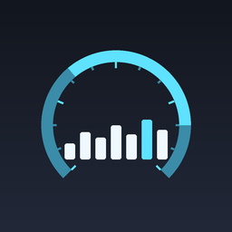

# iOS-MetalHUD-Injector

<p align="center">
  
</p>

<p align="center">
  <a href="README.md">简体中文</a> ·
  <a href="README.en.md">English</a> ·
  <b>繁體中文</b>
</p>

<p align="center">
  用一台 iPhone／iPad 自己啟動 <b>App Store 應用程式</b> 並注入 <code>MTL_HUD_ENABLED</code>，
  讓 Metal 效能 HUD（即時 FPS／畫格時間）顯示出來。免 Mac、免 Xcode、不越獄。
</p>

<p align="center">
  <a href="https://github.com/wurezhwe/iOS-MetalHUD-Injector/actions/workflows/build.yml">
    
  </a>
</p>

---

## 這是什麼

iOS 設定裡的 **開發者 → 顯示圖形 HUD** 這個開關，只對帶有 `get-task-allow` 權限的程序生效
（Xcode 除錯建置、自簽應用程式）。App Store 應用程式沒有這個權限，所以那個開關對它們完全無效。

但 Metal 執行環境在程序啟動時會讀取環境變數，這條路徑**不檢查簽章**：

| 變數 | 作用 |
| --- | --- |
| `MTL_HUD_ENABLED` | `1` 開啟 HUD |
| `MTL_HUD_SCALE` | HUD 縮放比例，例如 `0.35` |
| `MTL_HUD_ALIGNMENT` | 對齊方式，例如 `top-right` |
| `MTL_HUD_LOG_ENABLED` | `1` 同時把 HUD 資料寫進記錄 |

只要能在啟動目標程序時把這些變數塞進去，HUD 就會出現。本專案做的就是這件事：

1. 應用程式在你自己的裝置上執行，透過一個 **回環 VPN**（LocalDevVPN／SideStore 的 WireGuard）
   存取裝置自身的 RSD（Remote Service Discovery）連接埠；
2. 用 RemotePairing 完成 pair-verify，建立 TLS-PSK 通道；
3. 在通道裡連上裝置內部 RSD，呼叫 **CoreDevice `appservice`** 的 `launchapplication`，
   把 `environmentVariables` 一併傳過去；
4. 目標應用程式帶著 HUD 啟動。

這條鏈路上 Xcode 用的是 `devicectl device process launch -e`，而 `devicectl` 只有 macOS 才有
——所以才需要「在裝置上自己跑一個用戶端」。

## 與參考專案的關係

| 參考 | 借鏡了什麼 |
| --- | --- |
| [wurezhwe/iOS-MetalHUD-Launcher](https://github.com/wurezhwe/iOS-MetalHUD-Launcher) | `MTL_HUD_*` 環境變數清單、`launch --env` 這條思路、遊戲類應用程式的啟發式判斷 |
| [Mak5er/AirCard-iOS](https://github.com/Mak5er/AirCard-iOS) | 裝置內 RPPairing host（在設定裡配對）、回環通道路由與候選閘道掃描、`idevice` 的 RSD／CoreDevice 呼叫方式 |

差別在於：前者必須在 **Windows 上插傳輸線**用 `pymobiledevice3` 啟動；本專案**全程在裝置上**完成
（配對 → 通道 → 啟動），產物是一個 IPA。

## 建置

不需要 Mac。Fork 本儲存庫，GitHub Actions 會自動建置：

```
Actions → Build IPA → Run workflow
```

建置成功後 `Release IPA` 會自動把產物發佈到 [Releases](../../releases)，標籤就是
`project.yml` 裡的 `MARKETING_VERSION`（目前 **v1.1.0**）：

```
https://github.com/wurezhwe/iOS-MetalHUD-Injector/releases/latest/download/MetalHUDLauncher.ipa
```

這個連結永遠指向最新版本，可以直接使用。也可以在單次執行頁面下載
`MetalHUDLauncher-ipa` 這個 artifact（壓縮檔裡是同一個檔案）。

發版時把 `project.yml` 裡的 `MARKETING_VERSION` 改一下，下一次成功建置就會
產生新的版本號標籤；版本號不變時會覆蓋同一個 release 裡的 IPA。

或者在本地有 macOS 時：

```bash
./scripts/build-rust.sh     # 編譯 Rust 靜態函式庫，產出 MetalHUDFFI.xcframework
brew install xcodegen
xcodegen generate
# 然後用 Xcode 開啟 MetalHUDLauncher.xcodeproj 建置，或沿用 CI 裡的 xcodebuild 指令
```

產出的 `MetalHUDLauncher.ipa` 是**未簽章**的，需要自己簽章安裝（見下）。

## 安裝

未簽章 IPA 不能直接安裝。任選其一：

| 方式 | 說明 |
| --- | --- |
| **SideStore／AltStore** | 最省事，也是建議路線：它能幫你產生配對檔，正好也給本應用程式用 |
| **TrollStore** | iOS 14.0–17.0 且支援的裝置上可直接永久安裝 |
| **iOS App Signer／Sideloadly** | 用你自己的開發者憑證重新簽章 |
| **Xcode** | 直接 Run 到裝置 |

> 本儲存庫的 CI 只負責編譯出 IPA，**不包含任何憑證或描述檔**。

## 使用

### 1. 準備回環 VPN

安裝 [LocalDevVPN](https://apps.apple.com/app/localdevvpn/id6475003729)（免費），開啟並連線。
它的作用是把 `10.7.0.1` 之類的位址轉送到裝置自身的開發服務連接埠。

已經裝了 **SideStore** 的話，它內建的 WireGuard 回環也能用，閘道同樣是 `10.7.0.1`。

### 2. 配對

iOS 27 起，App 可以反過來扮演「可配對的主機」，讓你在設定裡批准它：

1. 開啟 Metal HUD，點 **Start pairing host**；
2. 畫面會顯示一組 6 位數 PIN；
3. 進入 **設定 → 隱私權與安全性 → 開發者模式 → 與 MetalHUD 配對**；
4. 輸入 PIN。

配對完成後會寫入一份 `metalhud_pairing.plist` 到應用程式的 Documents 目錄。

**其它配對來源**（iOS 18–26 需要走這條路）：

- SideStore：`我的 iPhone › SideStore › ALTPairingFile.mobiledevicepairing`
- LiveContainer + SideStore：`我的 iPhone › LiveContainer › SideStore › Documents › ALTPairingFile.mobiledevicepairing`
- 在電腦上用 `jitterbugpair`／`pymobiledevice3` 產生後傳進來

在應用程式裡點 **Import pairing file** 選取即可（Documents 目錄已透過 `UIFileSharingEnabled` 開放給「檔案」App）。

### 3. 啟動帶 HUD 的應用程式

1. 點右上角重新整理，讀取已安裝應用程式清單；
2. 搜尋目標應用程式（支援中文、拼音、首字母，見下）；
3. 需要時調整 `Scale`／`Alignment`；
4. 點播放按鈕。

啟動成功後切回目標應用程式就能看到左上角（或你設定的位置）的 HUD。點 **Screenshot** 可以擷取畫面存證。

### 搜尋

輸入框三種寫法都認得：

| 輸入 | 命中 |
| --- | --- |
| `王者榮耀` | 直接比對中文名稱 |
| `wangzherongyao` | 全拼 |
| `wzry` | 拼音首字母 |
| `gen` / `com.mojang` | 英文名稱／bundle id 子字串 |

轉換在應用程式清單載入時**一次性**完成（不是每次按鍵），輸入本身也做了防抖，
所以幾百個應用程式下打字不會卡頓。

## 介面

介面使用 iOS 26 的 **Liquid Glass** 材質（`glassEffect`）：卡片、搜尋框、
按鈕都是真正的玻璃效果，並會跟隨系統的液態玻璃動畫。iOS 16–25 上會自動退回
霧面玻璃材質，版面完全一致。

| 區域 | 作用 |
| --- | --- |
| Pairing record | 顯示是否已有配對檔，可 Forget／Import |
| Gateway | RSD 撥號位址，預設 `10.7.0.1`；旁邊 Apply 會重新推送候選位址清單 |
| Probe | 只建立通道不啟動應用程式，回報裝置開了多少服務、有沒有 appservice／dvt |
| 注入環境 | 即時顯示將要注入的環境變數 |
| Installed apps | 應用程式清單 + 搜尋 + 啟動 |
| Tunnel log | 通道與啟動過程的即時記錄，可複製 |

## 疑難排解

**`could not reach the device`**
閘道不對或 VPN 沒連上。先在 Gateway 裡確認位址，再點 Probe 看記錄裡試了哪些位址。

**`pair-verify rejected`**
配對檔與目前裝置不符（重裝系統、換裝置，或配對檔來自別的裝置）。刪掉配對記錄重新配對。

**`the device never accepted a tunnel connection`**
回環 VPN 轉送了 RSD 連接埠，但沒轉送裝置臨時開啟的通道連接埠。換一個 VPN，或重新連線 VPN 後再試。

**啟動報錯但應用程式清單正常**
部分遊戲有反除錯保護，會拒絕以除錯方式啟動，這類應用程式無法用本工具。

**Probe 顯示 `appservice=no`**
正常。不少系統版本並不在 RSD 裡公佈 `com.apple.coredevice.appservice`，
但一定會公佈 `com.apple.instruments.dtservicehub`。本工具會依
DVT → CoreDevice → InstallationProxy 的順序自動退回，不需要手動切換。
記錄裡出現 `DVT application listing failed` 再看到 coredevice 失敗才是真正的問題。

**HUD 不出現**
先確認目標應用程式確實用 Metal 算圖（絕大多數遊戲和大量一般應用程式都是）。系統內建應用程式可能忽略該變數。

## 運作原理（細節）

```
┌─────────────────────────── 裝置內部 ───────────────────────────┐
│                                                                │
│   MetalHUDLauncher.app                                         │
│        │                                                       │
│        │  1. RPPairing host（Bonjour 廣播，設定裡批准 PIN）      │
│        ▼                                                       │
│   配對檔 metalhud_pairing.plist                                  │
│        │                                                       │
│        │  2. 連 10.7.0.1:49152 (RSD) → RemoteXPC 握手            │
│        │     → RPPairing pair-verify                            │
│        │     → createListener 取得通道連接埠                     │
│        ▼                                                       │
│   TLS-PSK + CDTunnel 握手 → 通道內 RSD (serverRSDPort)          │
│        │                                                       │
│        │  3. 依序挑一條可用的啟動通道                            │
│        │     a) DVT com.apple.instruments.dtservicehub          │
│        │        → processcontrol                               │
│        │        launchSuspendedProcessWithDevicePath:...        │
│        │     b) CoreDevice com.apple.coredevice.appservice      │
│        │        → launchapplication                             │
│        ▼                                                       │
│   環境字典 {MTL_HUD_ENABLED: "1", MTL_HUD_SCALE: "0.35", ...}   │
│        │                                                       │
│        ▼                                                       │
│   目標 App 帶著 HUD 啟動                                        │
└────────────────────────────────────────────────────────────────┘
```

為什麼要兩條通道：`com.apple.coredevice.appservice` 並不是每個系統版本都
在 RSD 裡公佈（實測某台 iPadOS 只公佈 63 個服務、其中沒有它），而
`dtservicehub` 幾乎總是在。兩條通道都能帶 `environmentVariables`，注入效果一致。

`rust-core` 裡對應三個模組：

- `tunnel.rs` — 撥號、pair-verify、通道、通道內 RSD 握手
- `launch.rs` — 列出應用程式（DVT → coredevice → InstallationProxy）、
  啟動（DVT → coredevice）、截圖（coredevice → screenshotr）
- `pairing.rs` — 裝置內的 RPPairing host

## 目錄結構

```
.
├── rust-core/                     # Rust 靜態函式庫（C ABI）
│   ├── src/
│   │   ├── lib.rs                 # 對外 C 介面
│   │   ├── tunnel.rs              # RemotePairing → RSD 通道
│   │   ├── launch.rs              # 應用程式清單／啟動／截圖
│   │   ├── pairing.rs             # 裝置內 RPPairing host
│   │   ├── logging.rs             # 記錄回呼橋接
│   │   └── ffi_util.rs            # C 字串與大堆疊執行緒
│   └── include/metalhud.h
├── ios-app/                       # SwiftUI 應用程式
│   ├── MetalHUDApp.swift
│   ├── ContentView.swift
│   ├── AppModel.swift
│   ├── AppSearchIndex.swift       # 搜尋索引（拼音／首字母，一次性折疊）
│   ├── GlassKit.swift             # Liquid Glass 元件 + 舊系統退回
│   ├── Bridge.swift               # FFI 封裝
│   ├── PairingController.swift    # 配對 + Bonjour
│   ├── NetworkStatus.swift        # 網路介面與候選閘道
│   ├── Utilities.swift            # 保持執行／本地網路權限
│   └── Info.plist
├── scripts/
│   ├── build-rust.sh              # 編譯 Rust 並打包 xcframework
│   ├── make_icon.py               # 產生圖示
│   ├── check_readmes.py           # 檢查三份 README 的完整性
│   └── check_locales.py           # 檢查簡繁用字不互相混用
├── README.md                      # 简体中文
├── README.en.md                   # English
├── README.zh-TW.md                # 繁體中文
├── project.yml                    # XcodeGen
└── .github/workflows/
    ├── build.yml                  # 建置 IPA
    └── release.yml                # 用 MARKETING_VERSION 發版
```

## 相容性

| iOS | 說明 |
| --- | --- |
| 27.x | 支援，可在設定裡直接配對 |
| 18 – 26.x | 支援，需要匯入配對檔（SideStore／LiveContainer／電腦產生） |

## 授權

MIT。參考專案同樣是 MIT。

`MTL_HUD_*` 是 Apple Metal 執行環境未公開文件的環境變數；本專案只是把它們透過公開的
CoreDevice 介面傳進去，不修改任何應用程式。
